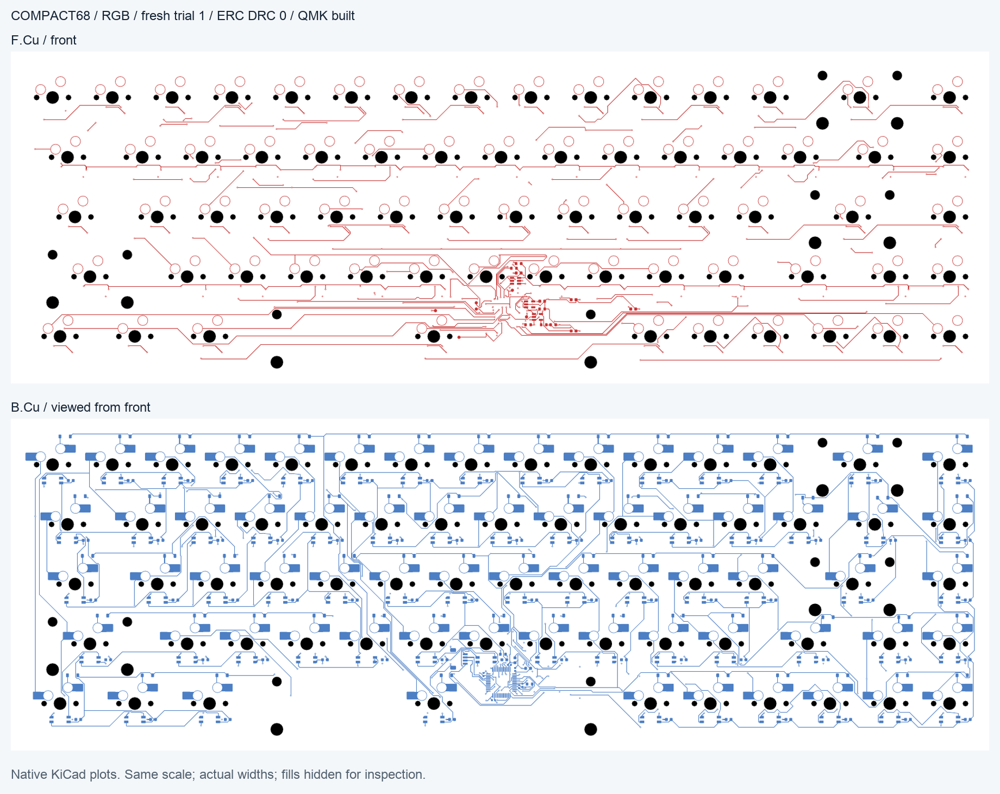

# SmilePCB

[](LICENSE)
[](https://github.com/joxerx/smilepcb/releases)

**Keyboard layouts → KiCad PCB projects and matching QMK firmware.**

SmilePCB combines reusable circuit rules, component placement, GPIO assignment,
routing and native checks. It builds on public keyboard designs and established
community tools rather than replacing KiCad or QMK.

**0.2.0rc1 is an experimental prerelease.**
Four fresh builds passed the complete software workflow on the tested stack:
two each of the supplied 61-key and 68-key RGB layouts, two copper layers,
zero native ERC/DRC findings under the
[documented rule profile](docs/workflows/stm32.md#rule-scope), zero independent
connectivity gaps and clean matching QMK builds.

| Layout | Fresh trials passed | Full command time | Largest process peak RSS |
| --- | --- | --- | --- |
| ANSI61 + RGB | 2/2 | 20:20–20:42 | 905–913 MiB |
| compact68 + RGB | 2/2 | 28:12–30:22 | 847–945 MiB |

Times include all internal attempts. Memory is the largest individual supervised
process, not a simultaneous process-tree total. See the
[exact measurements and source fingerprints](docs/qualification/0.2.0rc1.json).
These samples qualify the supplied fixtures and runtime only. They do not
guarantee completion, identical copper or reference-quality appearance for
another run or layout. Incomplete runs retain diagnostics and are not accepted.
Generated hardware has not been fabricated or tested. No speed or memory
improvement against an unmatched baseline is claimed.

## Supported workflow

- STM32F072CBT6 with a USB-C daughterboard connection.
- MX hot-swap switches and SK6812MINI-E per-key RGB with cutouts.
- Placement and matrix GPIO assignment based on available geometry.
- Controller interfaces, rows, columns and RGB routing, with bounded global recovery.
- KiCad schematic/PCB/project, BOM, firmware sources, compiled firmware and checks.

Start with the supplied `ansi61` or `compact68` layout. Arbitrary KLE layouts,
controller families and existing boards are outside this candidate workflow.
A layout also needs a `keyboard.json` sidecar for its electrical/firmware choices.

## Quick start

Tested native stack: macOS arm64, KiCad 10.0.7, Java 25 and Freerouting 2.5.0.
Host Python requires 3.11+. KiCad and the QMK/ARM toolchain are installed separately.
Other platforms have not been checked for native operations.

```sh
git clone https://github.com/joxerx/smilepcb.git
cd smilepcb
python3 -m venv .venv
.venv/bin/python -m pip install -e '.[test]'
```

Follow the [STM32 setup and build guide](docs/workflows/stm32.md) to configure
external tools and fetch the pinned public controller source, then run:

```sh
.venv/bin/python recipes/stm32/generate.py \
  .lab/tools.json first-ansi61 \
  --fixture ansi61 --native-staged \
  --process-profile fr4-2l-1oz-0p5-0p2 \
  --optimize-matrix-gpio --completion-budget-s 3600 \
  --routing-quality turns
```

For the other supplied layout, use `--fixture compact68` and a new run tag.
Results go under `.lab/public-controller/<tag>/`. Existing tags are not overwritten.
The command accepts a result only after native rule, connectivity and firmware
checks; failed runs retain diagnostics. Runtime and routing success depend on the
layout and toolchain. The completion budget is not a deadline for the whole run.

## Routing changes in 0.2.0rc1

The candidate fixes copper artwork/field obstacles and routed-net clearance
checks. The existing routing policy remains the default. Add
`--routing-quality turns` to the native staged command to test positive bend
costs, heading-aware search and ranked simple paths. Both modes share USB
preparation and the external global router's cost model. Native completion and
recovery receive the selected mode; result files record it.

Preparation now prefers connected signal banks when placing controller supports,
tries coupled 45-degree USB joins, and reuses existing local return vias. The
existing native packing, clearance and source-preservation checks remain required.

Recovery now keeps failed-attempt history across stages and orders native
connection groups by geometry. Its final disposable search can move generated
neighbors more readily, while accepting only a fully connected, checked result.

This option does not guarantee a complete route, fewer vias or reference-quality
appearance. It does not change fabrication rules, widths, budgets or admission.
See the [routing policy](docs/workflows/stm32.md#routing-quality).

## Example output



Native KiCad plots from trial 1; both faces are viewed from the front. Ground
fills are hidden in a display copy for inspection; source copper is unchanged.
The controller region remains dense. See the
[61-key RGB example](docs/images/0.2.0rc1-ansi61-rgb.png) and the measured report
for the source PCB and image hashes.

## CLI and MCP

The full STM32 workflow currently requires a **source checkout** and the recipe
command above. The wheel contains the core CLI/MCP package; it does not include
the repository recipe. The older `smilepcb build` command is a separate path.

For the installed CLI's bounded synthetic RGB demo and local stdio MCP server,
see [CLI and MCP usage](docs/workflows/cli-mcp.md). MCP supports inspect, plan,
preview, apply, verify and encoder rollback for its supported synthetic profiles.
It does not yet expose the full STM32 generator.

## Development and references

```sh
.venv/bin/python -m pytest -q
```

Portable policy and driver tests run without native CAD. Native geometry tests
are enabled with `SMILEPCB_KICAD_PYTHON` pointing to KiCad's bundled interpreter;
a separate symbol-library check is also optional. Full PCB/firmware qualification
requires the toolchain in the build guide.
CI checks Python 3.11/3.14 and packaging.

- `smilepcb/`: circuit model, native workers, routing, validation, CLI and MCP.
- `recipes/stm32/`: executable generation recipe and two input layouts.
- [Rules and sources](docs/sources.md): public references behind the recipes.
- [Contributing](CONTRIBUTING.md): bug reports, feature/recipe proposals and PRs.
- [Changelog](CHANGELOG.md), [security policy](SECURITY.md), [code of conduct](CODE_OF_CONDUCT.md).

This repository contains curated source snapshots for releases. Generated CAD,
local toolchains and development logs are excluded.

## License

Original SmilePCB code is [MIT](LICENSE). Bundled marbastlib assets retain
CERN-OHL-P-2.0. External donor designs, KiCad, QMK and Freerouting keep their own
licenses; generated CAD is not automatically MIT. See [third-party notices](THIRD_PARTY_NOTICES.md).
